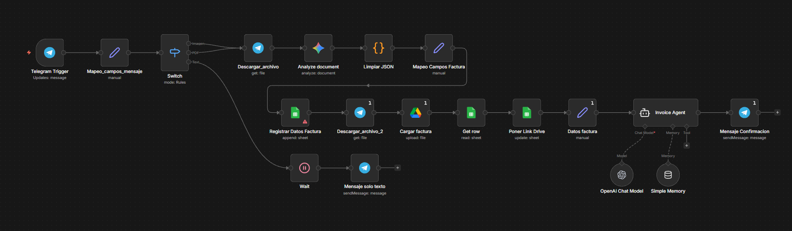
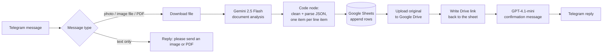
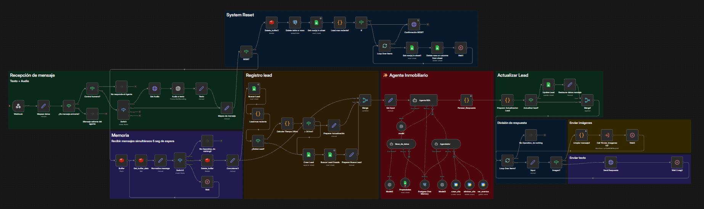
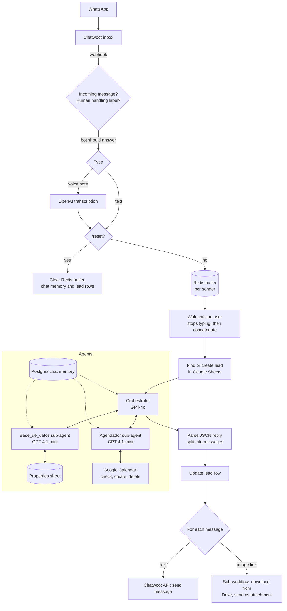

# n8n AI Automations

Two LLM workflows I built and ran in production for small businesses in Guadalajara, Mexico. Both run on n8n, which I self-hosted with Docker on a Linux VPS (EasyPanel) together with Chatwoot and Redis.

| Project | Channel | Models | Result |
|---|---|---|---|
| [Invoice extraction bot](#1-invoice-extraction-bot-g-parts) for G-Parts, a printer parts distributor | Telegram | Gemini 2.5 Flash, GPT-4.1-mini | 500+ invoices processed |
| [Real estate WhatsApp agent](#2-real-estate-whatsapp-agent-mercado-casas-y-depas) for Mercado Casas y Depas | WhatsApp via Chatwoot | GPT-4o (orchestrator), GPT-4.1-mini (sub-agents), OpenAI audio transcription | 25+ property viewings booked |

The prompts and node names are in Spanish because the end users are Mexican customers. Client data, credentials and IDs were removed before publishing (see [Running the workflows](#running-the-workflows)).

```
n8n-ai-automations/
├── invoice-extraction-telegram/
│   ├── invoice-extraction.json
│   └── screenshots/
└── real-estate-whatsapp-agent/
    ├── rea-whatsapp-agent.json        # main workflow (orchestrator + sub-agents)
    ├── send-images-subworkflow.json   # called by the main workflow to send property photos
    └── screenshots/
```

---

## 1. Invoice extraction bot (G-Parts)

Someone on the G-Parts team sends a photo or PDF of a supplier invoice to a Telegram bot. The workflow extracts every line item into Google Sheets, archives the original file in Google Drive and replies with a summary.





**How it works**

The first node classifies the incoming Telegram message as image, PDF, voice, video or text (images sent as files are detected by MIME type). Text-only messages get a short reply asking for a file; images and PDFs are downloaded and sent to Gemini 2.5 Flash.

The extraction prompt asks Gemini for a single JSON object with a fixed schema: invoice number, date (ISO), supplier, currency, payment method, credit due date, subtotal, VAT, total, and a list of line items (part number, description, quantity, unit price, category). The prompt also includes rules specific to Mexican invoices:

- Use the visible invoice number, not the *folio fiscal* (the UUID on Mexican CFDI invoices).
- Identify the supplier by the company that issues the invoice (the logo), not the customer.
- Only fill the credit due date when the payment method is credit or PPD; return `null` for PUE, cash or transfer.
- If VAT is missing, compute it as `total - subtotal`. Process every page of multi-page PDFs.

A JavaScript code node strips markdown fences from the model output, parses the JSON and throws a clear error if it is invalid. It then splits the invoice into one n8n item per line item, so the sheet ends up as a ledger of parts with the invoice header repeated on each row.

After the rows are written, the original file is uploaded to Drive as `Factura_{supplier}_{date}` and its link is written back into the sheet. Finally, a small agent (GPT-4.1-mini) formats a confirmation message in Telegram HTML with the invoice number, supplier, date, total and a link to the sheet.

**Sheet columns:** `No. factura, Fecha factura, Proveedor, No_parte, Concepto, Cantidad, Precio Unitario, Categoria, Subtotal, IVA, Total, Moneda, Metodo de Pago, Vencimiento Credito, Enlace factura`

---

## 2. Real estate WhatsApp agent (Mercado Casas y Depas)

A WhatsApp assistant for a real estate agency. It asks what the client is looking for, recommends three properties from the agency's catalog, sends photos, books viewings in Google Calendar and keeps a lead record in Google Sheets. A human agent can take over a conversation at any time.





**Message handling.** Chatwoot connects the WhatsApp number and forwards every event to an n8n webhook. The workflow ignores outgoing messages, and it also stays silent when a conversation has the `human_handling` label, which is how a sales agent takes over from the bot. Voice notes are downloaded and transcribed with OpenAI. People on WhatsApp often send three or four short messages in a row, so each message is pushed to a Redis list keyed by the sender's phone number. The workflow keeps waiting until about 10 seconds pass without a new message, then joins everything in the buffer into one input and clears it. This way the agent answers once instead of replying to every fragment.

**Lead tracking.** Before calling the agent, the workflow looks up the sender in a Google Sheet. If there is no lead, or the last one is older than 24 hours, it creates a new row; otherwise it reuses the existing one and passes the name and row number to the agent.

**Agents.** The orchestrator (GPT-4o) runs the conversation in six steps: welcome, preferences, confirmation, recommendation, details and closing. It always asks first whether the client wants to buy, rent or buy pre-construction, since that decides which properties can be shown. It has two sub-agents as tools, and all three share the same Postgres chat memory (context window of 10, keyed by phone number):

- `Base_de_datos` queries the property catalog sheet and always returns three options. If fewer than three match exactly, it searches again keeping the operation and property type fixed and relaxing the rest: nearby zones, price ±20%, bedrooms ±1.
- `Agendador` handles viewings with Google Calendar tools. It checks availability before booking, avoids overlaps, only books Monday to Saturday from 9:00 to 18:00 in one-hour slots, and can cancel or reschedule.

**Output contract.** The orchestrator must answer with a JSON object instead of free text:

```json
{
  "reply": "message for the user",
  "intencion": "bienvenida | toma_preferencias | recomendacion | derivar_humano | ...",
  "paso": "1-6",
  "requiere_agente_humano": false,
  "datos_cliente": { "lead_row_number": 12, "nombre": null, "telefono": null, "email": null },
  "preferencias": { "operacion": null, "tipo": null, "zona": null, "presupuesto_min": null, "presupuesto_max": null, "habitaciones_min": null, "habitaciones_max": null, "amenidades_deseadas": [], "notas_adicionales": null },
  "recomendaciones": []
}
```

The prompt includes a table for turning spoken budgets into numbers ("around 3 million" becomes 2.7M to 3.3M, "up to 4M" becomes 2M to 4M, and so on). A code node extracts the JSON even when the model wraps it in markdown or uses curly quotes, writes the client data and preferences back to the lead row, and splits the reply into separate WhatsApp messages. Text parts go out through the Chatwoot API with a short pause between them; image links go to the `send-images` sub-workflow, which downloads the photo from Google Drive and posts it to the conversation as an attachment.

**Testing command.** Sending `/reset` clears the Redis buffer, the chat memory and the sender's lead rows, so the conversation can be tested from scratch.

**Lead sheet columns:** `Timestamp, Nombre, Telefono, Tipo_propiedad, Tipo_operacion, Zona, Presupuesto_min, Presupuesto_max, Recamaras, Amenidades, Estado, Ultima_actualizacion`

---

## Stack

| Layer | Tools |
|---|---|
| Orchestration | n8n (self-hosted, Docker, EasyPanel on a Linux VPS) |
| LLMs | OpenAI GPT-4o, GPT-4.1-mini, audio transcription; Google Gemini 2.5 Flash |
| Messaging | Telegram Bot API, WhatsApp through Chatwoot (self-hosted) |
| Data | Google Sheets, Google Drive, Google Calendar, Redis, PostgreSQL (Supabase) |
| Custom logic | JavaScript code nodes for parsing, cleaning and JSON transformation |

## Running the workflows

1. In n8n, go to **Workflows → Import from file** and import the JSON files. For the real estate agent, import `send-images-subworkflow.json` first, then open the `Call 'Enviar_Imagenes V3'` node in the main workflow and select the imported sub-workflow.
2. Create the credentials the nodes ask for: OpenAI, Google Gemini, Google Sheets / Drive / Calendar (OAuth2 or a service account), Telegram, Redis and Postgres.
3. Replace the placeholders:

| Placeholder | Where |
|---|---|
| `YOUR_SHEET_ID`, `YOUR_SHEET_URL` | Google Sheets nodes and the invoice confirmation prompt |
| `YOUR_FOLDER_ID`, `YOUR_FOLDER_URL` | Google Drive nodes |
| `YOUR_CALENDAR_ID@group.calendar.google.com` | Google Calendar tools |
| `YOUR_CHATWOOT_HOST`, `YOUR_CHATWOOT_TOKEN` | HTTP Request nodes that call the Chatwoot API |

4. In Chatwoot, point the inbox webhook to the n8n webhook path `chatwoot2`.

Old disabled nodes from earlier versions (a GPT-4o image extraction path, among others) were removed from these exports, so the canvas only shows what ran in production.
